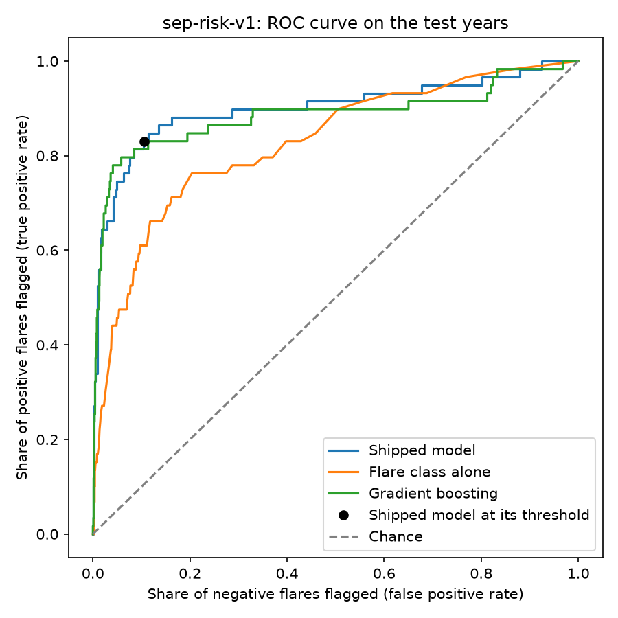
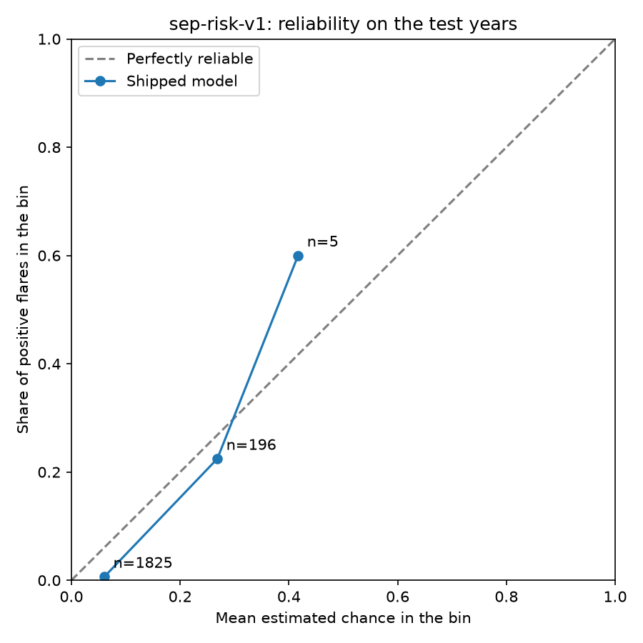
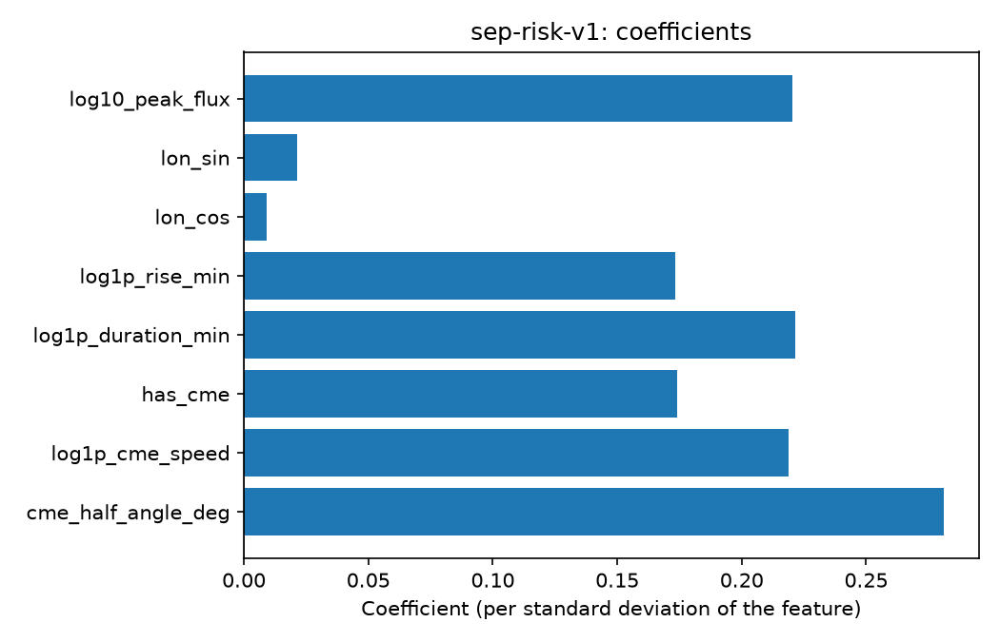

# Model card: sep-risk v1

Generated by `ml/train_sep_risk.py` on 2026-11-14T19:57:49Z. Every number below is written by the script. Do not edit this file by hand.

## Purpose

For a solar flare of class M1.0 or above, the model gives an output between 0 and 1 for whether NASA DONKI analysts link it to a solar energetic particle (SEP) event that an instrument observed. The app shows this output to the crew as an "Experimental model score" out of 100, never as a percent chance; "Reliability on the test years" below shows how the output compares with what was recorded.

In the app the estimate may raise one watch-level alert, `R-RAD-03`, labeled "Model estimate". It never raises an act-level alert and never changes a route by itself.

It is a logistic regression on eight features from DONKI flare and CME records, evaluated on held-out years. It is a prototype for a hackathon, not an operational forecast.

## Data and retrieval

- Source: NASA CCMC DONKI (NASA Community Coordinated Modeling Center), from `https://ccmc.gsfc.nasa.gov/DONKI-API/get/`.
- Retrieved from 2026-11-14T17:27:07Z to 2026-11-14T17:57:49Z, for 2010-01-01 to 2026-10-31.
- Raw records: 3399 flares, 10332 CMEs and 494 SEP records. The raw files are only read, never changed.
- Flares used: peak times from 2010-06-12T00:57Z to 2026-10-19T09:03Z.
- Catalogs: FLR: M2M_CATALOG (3399); CME: M2M_CATALOG (10331), SWPC_ANNEX_CME_CATALOG (1); SEP: no catalog field (494).
- DONKI describes its content as experimental research information. Official U.S. space weather forecasts come from NOAA's Space Weather Prediction Center.

## Label and selection policy

Team decision D22 (ARCHITECTURE.md section 26.4):

- **Positive (1):** DONKI links the flare, directly or through one linked CME, to at least one SEP record observed by an instrument.
- **Excluded as ambiguous:** the linked SEP records are all model output or of unknown origin; excluded from training and testing, never counted as negative.
- **Negative (0):** no qualifying recorded SEP association; this is not proof that no particle event occurred.

Why: 140 of the 494 SEP records are model output, not measurements. Counting them would let model output become the answer this model learns. Turning them into negatives would hide real uncertainty.

### Instrument names and their classes

A name counts as `observed` only when official instrument documentation shows an instrument that measures particles and the DONKI record context fits a measurement. A name that starts with `MODEL:` is `model`, also when it contains a real instrument. Every other name is `unknown`.

Checked on 2026-11-15 by: Claude Code. Pages were retrieved by a web fetch service on its behalf and read on that day. Nobody on the team has re-read them yet.

| Instrument name in DONKI | Class | SEP records | Basis | Sources |
|---|---|---|---|---|
| `ACE: EPAM >30 MeV` | unknown | 1 | Not supported. The ACE Science Center documents EPAM ions only up to about 5 MeV per nucleon, and none of the pages read gives EPAM a proton channel above 30 MeV. EPAM is a real instrument, but this name does not match its documented channels. | [EPAM Level 2 Data Documentation](https://izw1.caltech.edu/ACE/ASC/level2/epam_l2desc.html), [SIS Level 2 Data Documentation](https://izw1.caltech.edu/ACE/ASC/level2/sis_l2desc.html), [ACE Real-Time Solar Wind](https://www.spaceweather.gov/products/ace-real-time-solar-wind) |
| `GOES-P: SEISS >10 MeV` | observed | 51 | NOAA documents SEISS as a particle instrument whose SGPS measures protons in place from 1 to 500 MeV, and NOAA publishes integral proton fluxes at and above 10 MeV as observed on the primary GOES satellite. | [Space Environment In-Situ Suite (SEISS)](https://www.nesdis.noaa.gov/our-satellites/currently-flying/goes-east-west/space-environment-situ-suite-seiss-0), [GOES-R Space Environment In Situ Suite (SEISS)](https://www.ncei.noaa.gov/products/goes-r-space-environment-in-situ), [GOES Proton Flux](https://www.spaceweather.gov/products/goes-proton-flux) |
| `GOES-P: SEISS >100 MeV` | observed | 12 | As for the channel above 10 MeV: the SGPS range covers 100 MeV, and NOAA publishes an integral proton flux at and above 100 MeV as observed on the primary GOES satellite. | [Space Environment In-Situ Suite (SEISS)](https://www.nesdis.noaa.gov/our-satellites/currently-flying/goes-east-west/space-environment-situ-suite-seiss-0), [GOES-R Space Environment In Situ Suite (SEISS)](https://www.ncei.noaa.gov/products/goes-r-space-environment-in-situ), [GOES Proton Flux](https://www.spaceweather.gov/products/goes-proton-flux) |
| `GOES13: SEM/EPS >10 MeV` | observed | 45 | NOAA NCEI documents the EPS detectors as measuring proton fluxes, says the integral proton fluxes are derived from the instrument channels, and lists GOES-13 data for the years in which DONKI uses this name. | [GOES 1-15 Space Weather Instruments](https://www.ncei.noaa.gov/products/goes-1-15/space-weather-instruments), [GOES Proton Flux](https://www.spaceweather.gov/products/goes-proton-flux) |
| `GOES13: SEM/EPS >100 MeV` | observed | 11 | As for the channel above 10 MeV. | [GOES 1-15 Space Weather Instruments](https://www.ncei.noaa.gov/products/goes-1-15/space-weather-instruments), [GOES Proton Flux](https://www.spaceweather.gov/products/goes-proton-flux) |
| `MODEL: REleASE:ACE/EPAM 15.8-39.8 MeV` | model | 44 | The name starts with MODEL:, which is enough under decision D22. The instrument named after the model is treated as the model's input, not as an observation. No REleASE documentation could be retrieved. | none |
| `MODEL: REleASE:ACE/EPAM 28.2-50.1 MeV` | model | 25 | As for the 15.8-39.8 MeV name. | none |
| `MODEL: REleASE:SOHO/EPHIN 15.8-39.8 MeV` | model | 46 | The name starts with MODEL:, which is enough under decision D22. The instrument named after the model is treated as the model's input, not as an observation. No REleASE documentation could be retrieved. | none |
| `MODEL: REleASE:SOHO/EPHIN 28.2-50.1 MeV` | model | 25 | As for the 15.8-39.8 MeV name. | none |
| `SOHO: COSTEP 15.8-39.8 MeV` | observed | 74 | The instrument team documents COSTEP as measuring energetic particles from the Sun, with EPHIN covering hydrogen from 4 to more than 53 MeV, which contains this channel. The page does not list this channel itself. | [SOHO - COSTEP (Comprehensive Suprathermal and Energetic Particle Analyzer)](https://www.ieap.uni-kiel.de/et/ag-heber/costep/), [EPHIN (Electron Proton Helium Instrument)](https://www.ieap.uni-kiel.de/et/ag-heber/costep/ephin.php) |
| `SOHO: COSTEP 28.2-50.1 MeV` | observed | 38 | As for the 15.8-39.8 MeV channel: the documented EPHIN range contains this channel. | [SOHO - COSTEP (Comprehensive Suprathermal and Energetic Particle Analyzer)](https://www.ieap.uni-kiel.de/et/ag-heber/costep/), [EPHIN (Electron Proton Helium Instrument)](https://www.ieap.uni-kiel.de/et/ag-heber/costep/ephin.php) |
| `STEREO A: IMPACT 13-100 MeV` | observed | 92 | The instrument paper documents that the High Energy Telescope, carried on each of the two STEREO spacecraft, measures protons from about 13 to about 100 MeV. The energy range in the DONKI name matches it. | [The High Energy Telescope for STEREO](https://izw1.caltech.edu/STEREO/docs/STEREO-HET-SSR.pdf), [The SEP Instrument Suite on STEREO](https://izw1.caltech.edu/STEREO/) |
| `STEREO B: IMPACT 13-100 MeV` | observed | 30 | As for STEREO-A: the same telescope flew on both spacecraft. | [The High Energy Telescope for STEREO](https://izw1.caltech.edu/STEREO/docs/STEREO-HET-SSR.pdf), [The SEP Instrument Suite on STEREO](https://izw1.caltech.edu/STEREO/), [STEREO A & B](https://science.nasa.gov/mission/stereo/) |

### SEP record classes

A record is observed-only when every instrument name is observed, mixed when it has an observed name together with model or unknown names, model-only when every name is model, and unknown otherwise. Observed-only and mixed records count as instrument-observed.

| Split | Observed-only | Mixed | Model-only | Unknown |
|---|---|---|---|---|
| train (2010-2020) | 150 | 0 | 1 | 1 |
| validation (2021-2022) | 30 | 0 | 23 | 0 |
| test (2023-2026) | 173 | 0 | 116 | 0 |
| all | 353 | 0 | 140 | 1 |

| Year of the SEP record | Observed-only | Mixed | Model-only | Unknown |
|---|---|---|---|---|
| 2010 | 1 | 0 | 0 | 0 |
| 2011 | 24 | 0 | 0 | 1 |
| 2012 | 41 | 0 | 0 | 0 |
| 2013 | 31 | 0 | 0 | 0 |
| 2014 | 27 | 0 | 0 | 0 |
| 2015 | 10 | 0 | 0 | 0 |
| 2016 | 2 | 0 | 0 | 0 |
| 2017 | 12 | 0 | 1 | 0 |
| 2020 | 2 | 0 | 0 | 0 |
| 2021 | 11 | 0 | 2 | 0 |
| 2022 | 19 | 0 | 21 | 0 |
| 2023 | 44 | 0 | 31 | 0 |
| 2024 | 73 | 0 | 46 | 0 |
| 2025 | 36 | 0 | 24 | 0 |
| 2026 | 20 | 0 | 15 | 0 |

No record in this download is mixed: every SEP record lists exactly one instrument name, so there are no model or unknown parts inside observed records to report.

### Flare labels and exclusions

| Split | Positive | Negative | Excluded as ambiguous | Scored (positive + negative) |
|---|---|---|---|---|
| train (2010-2020) | 53 | 439 | 0 | 492 |
| validation (2021-2022) | 10 | 224 | 4 | 234 |
| test (2023-2026) | 59 | 1967 | 9 | 2026 |
| all | 122 | 2630 | 13 | 2752 |

| Flare peak year | Positive | Negative | Excluded as ambiguous |
|---|---|---|---|
| 2010 | 0 | 3 | 0 |
| 2011 | 9 | 21 | 0 |
| 2012 | 13 | 17 | 0 |
| 2013 | 8 | 19 | 0 |
| 2014 | 7 | 207 | 0 |
| 2015 | 8 | 118 | 0 |
| 2016 | 1 | 16 | 0 |
| 2017 | 6 | 37 | 0 |
| 2020 | 1 | 1 | 0 |
| 2021 | 4 | 26 | 0 |
| 2022 | 6 | 198 | 4 |
| 2023 | 16 | 363 | 3 |
| 2024 | 31 | 1001 | 4 |
| 2025 | 7 | 360 | 1 |
| 2026 | 5 | 243 | 1 |

Excluded flares by the kind of SEP record they reach: modelOnly: 13.
40 positive flares also reach model-only or unknown records; they stay positive.
A negative label means "no qualifying recorded SEP association". It does not show that no particle event occurred.

## Filters and drop counts

Of 3399 flare records, 2765 are eligible. Filters: GOES class M1.0 or above; begin and peak time present, and the peak not before the begin; source location parseable.

| Dropped because | Flares |
|---|---|
| class cannot be read | 0 |
| class below M1.0 | 631 |
| begin or peak time missing | 0 |
| peak time before begin time | 2 |
| source location cannot be read | 1 |

13 eligible flares have no usable end time (10 of them have an end time before the peak, which counts as missing). Their duration feature uses the training median.
772 eligible flares have a linked CME analysis.

## Features

| Feature | Group | In plain words |
|---|---|---|
| `log10_peak_flux` | Flare class | How strong the flare was: the logarithm of its peak X-ray flux, from the GOES class (for example X2.2) |
| `lon_sin` | Source location | Where on the Sun the flare was, east to west: the sine of its longitude, with west positive |
| `lon_cos` | Source location | How close to the centre of the disk the flare was: the cosine of its longitude |
| `log1p_rise_min` | Rise time | How fast the flare rose: the logarithm of the minutes from begin to peak |
| `log1p_duration_min` | Duration | How long the flare lasted: the logarithm of the minutes from begin to end |
| `has_cme` | CME | Whether DONKI links a coronal mass ejection (CME) analysis to the flare: 1 or 0 |
| `log1p_cme_speed` | CME | How fast that CME was: the logarithm of its speed in km/s (0 without a CME) |
| `cme_half_angle_deg` | CME | How wide that CME was: its half-angle in degrees (0 without a CME) |

Nothing known only after the particle event is used as a feature.

## Splits

By flare peak year (UTC), in time order. No shuffling across years.

| Split | Years | Flares scored | Positives | Share positive | Excluded as ambiguous |
|---|---|---|---|---|---|
| train | 2010-2020 | 492 | 53 | 10.8% | 0 |
| validation | 2021-2022 | 234 | 10 | 4.3% | 4 |
| test | 2023-2026 | 2026 | 59 | 2.9% | 9 |

The planned boundaries were kept: every split has at least 10 positives.

## Training choices

- Standardization (mean and scale) and the coefficients are fitted on the training years only.
- A missing end time uses the training median of `log1p_duration_min`: 3.0445.
- Logistic regression with an L2 penalty, the `lbfgs` solver, at most 1000 iterations, no class weights.
- `C` chosen on the validation years by ROC AUC, ties to the smaller value: C=0.01: 0.957, C=0.1: 0.951, C=1: 0.954, C=10: 0.954. Chosen: C=0.01.
- Threshold rule: Highest TSS on the validation set; ties go to the higher threshold. Value: 0.1787.
- The test years were scored once, after these choices. Nothing was chosen from them.
- Seed 42. Python 3.12.5, numpy 2.5.4, scikit-learn 1.9.1, pandas 3.1.1, matplotlib 3.11.2.

## Results

What the scores mean: ROC AUC says how well the estimates rank positive flares above negative ones (0.5 is chance, 1 is perfect). PR AUC is the average precision. The Brier score is the mean squared error of the estimates; its skill score compares it with always forecasting the training base rate (above 0 is better than that). TSS is the share of positives flagged minus the share of negatives flagged. HSS is the skill beyond chance agreement. The false alarm ratio is the share of flagged flares that were negative.

| Shipped model on | ROC AUC | PR AUC | Brier | Brier skill | TSS | HSS | Precision | Recall | False alarm ratio | TP / FP / TN / FN |
|---|---|---|---|---|---|---|---|---|---|---|
| validation (2021-2022) | 0.957 | 0.406 | 0.0352 | 0.220 | 0.871 | 0.365 | 0.256 | 1.000 | 0.744 | 10 / 29 / 195 / 0 |
| test (2023-2026) | 0.900 | 0.470 | 0.0257 | 0.255 | 0.725 | 0.277 | 0.191 | 0.831 | 0.809 | 49 / 207 / 1760 / 10 |

95% intervals on the test years (1000 of 1000 bootstrap resamples used, seed 42, percentile method): ROC AUC 0.840 to 0.954; TSS 0.628 to 0.820.

At the threshold the model flags 256 of the 2026 test flares (12.6%). 49 of the 59 positive flares are among them, and 207 of the flagged flares are negative.

The Brier skill above compares with always forecasting the training base rate (10.8%). The test years have a much lower share of positives (2.9%), so that reference is easy to beat. Against a constant forecast of the test years' own share, which nobody could know in advance, the Brier skill is 0.093.

### Comparison with the planned baselines, on the same test years

| Model | ROC AUC (95% interval) | PR AUC | TSS (95% interval) | Brier skill (training base rate) | Brier skill (test years' own base rate) |
|---|---|---|---|---|---|
| Shipped: logistic regression, eight features | 0.900 (0.840 to 0.954) | 0.470 | 0.725 (0.628 to 0.820) | 0.255 | 0.093 |
| Baseline: logistic regression on flare class alone | 0.827 (0.764 to 0.884) | 0.200 | 0.550 (0.430 to 0.665) | 0.098 | -0.099 |
| Benchmark: gradient boosting (not shipped) | 0.885 (0.822 to 0.947) | 0.476 | 0.717 (0.621 to 0.817) | 0.299 | 0.146 |
| Reference: always the training base rate (10.8%) | 0.500 by definition | n/a | 0.000 by definition | 0.000 by definition | n/a |

On the validation years the ROC AUC was 0.957 for the shipped model, 0.706 for flare class alone and 0.909 for gradient boosting.

- Shipped model minus flare class alone: ROC AUC +0.073 (95% interval 0.016 to 0.134); TSS +0.176 (95% interval 0.077 to 0.278). The whole interval is above zero: on the test years the shipped model had the higher ROC AUC than flare class alone. The whole interval is above zero: on the test years the shipped model had the higher TSS than flare class alone.
- Shipped model minus gradient boosting: ROC AUC +0.015 (95% interval -0.019 to 0.051); TSS +0.008 (95% interval -0.086 to 0.096). The interval includes zero: the test years do not show a difference in ROC AUC between the shipped model and gradient boosting. The interval includes zero: the test years do not show a difference in TSS between the shipped model and gradient boosting.

Each model has its own threshold, chosen by the same rule on the validation years. The intervals use the same resamples for every model.

### Reliability on the test years

| Model output | Flares | Mean output | Share that were positive |
|---|---|---|---|
| 0.0 to 0.2 | 1825 | 6.1% | 0.7% |
| 0.2 to 0.4 | 196 | 26.8% | 22.4% |
| 0.4 to 0.6 | 5 | 41.7% | 60.0% |
| 0.6 to 0.8 | 0 | n/a | n/a |
| 0.8 to 1.0 | 0 | n/a | n/a |

A reliable model has the two right-hand columns close to each other. Where the mean estimate is above the share that were positive, the estimates were too high.

### Plots



ROC curve: the shipped model's ROC AUC on the test years is 0.900; flare class alone gives 0.827 and gradient boosting 0.885.



Reliability: 1825 of the 2026 test flares fall in the lowest bin, where the mean estimate is 6.1% and 0.7% were positive.



Coefficients: the largest in size is `cme_half_angle_deg` (+0.281 per standard deviation).

## Model parameters

| Feature | Group | Mean | Scale | Coefficient |
|---|---|---|---|---|
| `log10_peak_flux` | Flare class | -4.5735 | 0.3985 | +0.2202 |
| `lon_sin` | Source location | 0.0517 | 0.7323 | +0.0213 |
| `lon_cos` | Source location | 0.5849 | 0.3448 | +0.0093 |
| `log1p_rise_min` | Rise time | 2.6094 | 0.9094 | +0.1735 |
| `log1p_duration_min` | Duration | 3.2203 | 0.9703 | +0.2214 |
| `has_cme` | CME | 0.3110 | 0.4629 | +0.1740 |
| `log1p_cme_speed` | CME | 2.0889 | 3.1241 | +0.2189 |
| `cme_half_angle_deg` | CME | 12.4431 | 20.3388 | +0.2811 |

Intercept: -2.4928. Output = 1 / (1 + exp(-(intercept + sum of coefficient x (value - mean) / scale))). The app shows it as an "Experimental model score": the output times 100, a whole number from 1 to 99, never a percent chance.

## Limitations

- DONKI links are analysts' judgments, and catalog practice changed over time (DONKI notes that the Moon to Mars Space Weather Analysis Office analyzed its primary catalog entries from June 2020 onward); labels carry that noise.
- DONKI keeps SEP records per instrument and energy channel, and some records are model output (instrument names starting MODEL:). A positive label means "linked to at least one SEP record observed by an instrument", not a particular intensity or energy. A negative label means "no qualifying recorded SEP association", not that no particle event occurred.
- Flares whose only SEP evidence is model output or of unknown origin are excluded as ambiguous. The model was neither trained nor tested on them.
- DONKI attributes some particle events to CMEs from the far side of the Sun with no visible flare. A flare-based model cannot see those.
- CME analyses can come hours after the flare, so the full estimate is not available in the first minutes.
- Positive labels rest on particle events recorded by instruments that DONKI lists and that official instrument documentation supports as measurements. Names without that support count as unknown. How well the estimate carries over to a crew elsewhere in the solar system is not tested.
- Positive cases are few, so the intervals are wide. This is a prototype estimate for a hackathon, not an operational forecast.
- The validation years hold only 10 positive flares out of 234, so the choice of C and the threshold rest on few cases.
- The share of positive flares differs between the splits: 10.8% in the training years, 4.3% in the validation years and 2.9% in the test years. DONKI lists many more flares per year in the recent years, so estimates learned from the early years can be too high or too low for the recent ones.
- On the test years the threshold flagged 256 flares, and 207 of them (80.9%) had no qualifying recorded SEP association; most alerts from this model are expected to be false alarms.
- On the test years the estimates below 20% were too high on average: the mean estimate was 6.1%, and 0.7% of those flares were positive.

## References

- Space Weather Database Of Notifications, Knowledge, Information (DONKI). NASA CCMC. https://ccmc.gsfc.nasa.gov/tools/DONKI (`donki`; not yet verified by the team)
- Using Machine Learning Methods to Forecast If Solar Flares Will Be Associated with CMEs and SEPs. The Astrophysical Journal (arXiv version linked; confirm the journal reference). https://arxiv.org/abs/1806.07117 (`sep-ml-inceoglu-2018`; not yet verified by the team)
- Analysis of SEP events and their possible precursors based on the GSEP Catalog. The Astrophysical Journal Supplement Series (arXiv version linked; confirm). https://arxiv.org/abs/2306.11318 (`sep-gsep-2023`; not yet verified by the team)
- EPAM Level 2 Data Documentation. ACE Science Center, Caltech. https://izw1.caltech.edu/ACE/ASC/level2/epam_l2desc.html (instrument documentation, `ml/sep_instrument_classes.json`)
- SIS Level 2 Data Documentation. ACE Science Center, Caltech. https://izw1.caltech.edu/ACE/ASC/level2/sis_l2desc.html (instrument documentation, `ml/sep_instrument_classes.json`)
- ACE Real-Time Solar Wind. NOAA / NWS Space Weather Prediction Center. https://www.spaceweather.gov/products/ace-real-time-solar-wind (instrument documentation, `ml/sep_instrument_classes.json`)
- Space Environment In-Situ Suite (SEISS). NOAA NESDIS. https://www.nesdis.noaa.gov/our-satellites/currently-flying/goes-east-west/space-environment-situ-suite-seiss-0 (instrument documentation, `ml/sep_instrument_classes.json`)
- GOES-R Space Environment In Situ Suite (SEISS). NOAA NCEI. https://www.ncei.noaa.gov/products/goes-r-space-environment-in-situ (instrument documentation, `ml/sep_instrument_classes.json`)
- GOES Proton Flux. NOAA / NWS Space Weather Prediction Center. https://www.spaceweather.gov/products/goes-proton-flux (instrument documentation, `ml/sep_instrument_classes.json`)
- GOES 1-15 Space Weather Instruments. NOAA NCEI. https://www.ncei.noaa.gov/products/goes-1-15/space-weather-instruments (instrument documentation, `ml/sep_instrument_classes.json`)
- SOHO - COSTEP (Comprehensive Suprathermal and Energetic Particle Analyzer). Institute for Experimental and Applied Physics, University of Kiel (instrument team site). https://www.ieap.uni-kiel.de/et/ag-heber/costep/ (instrument documentation, `ml/sep_instrument_classes.json`)
- EPHIN (Electron Proton Helium Instrument). Institute for Experimental and Applied Physics, University of Kiel (instrument team site), based on R. Mueller-Mellin and others, Solar Physics 162, 483-504 (1995). https://www.ieap.uni-kiel.de/et/ag-heber/costep/ephin.php (instrument documentation, `ml/sep_instrument_classes.json`)
- The High Energy Telescope for STEREO. T. T. von Rosenvinge and others, Space Science Reviews 136, 391-435 (2008), DOI 10.1007/s11214-007-9300-5; copy hosted by the instrument team at Caltech. https://izw1.caltech.edu/STEREO/docs/STEREO-HET-SSR.pdf (instrument documentation, `ml/sep_instrument_classes.json`)
- The SEP Instrument Suite on STEREO. Caltech Space Radiation Laboratory (instrument team site). https://izw1.caltech.edu/STEREO/ (instrument documentation, `ml/sep_instrument_classes.json`)
- STEREO A & B. NASA Science. https://science.nasa.gov/mission/stereo/ (instrument documentation, `ml/sep_instrument_classes.json`)

## How to reproduce

```
python -m venv .venv                      # then activate it
pip install -r ml/requirements.txt
python ml/build_dataset.py                # flares.csv and dataset_summary.json from the raw DONKI files
python ml/train_sep_risk.py --seed 42       # this card, the model file, the parity file and the plots
python -m unittest discover -s ml/tests
```

A second run gives the same model file apart from `createdAt`.
