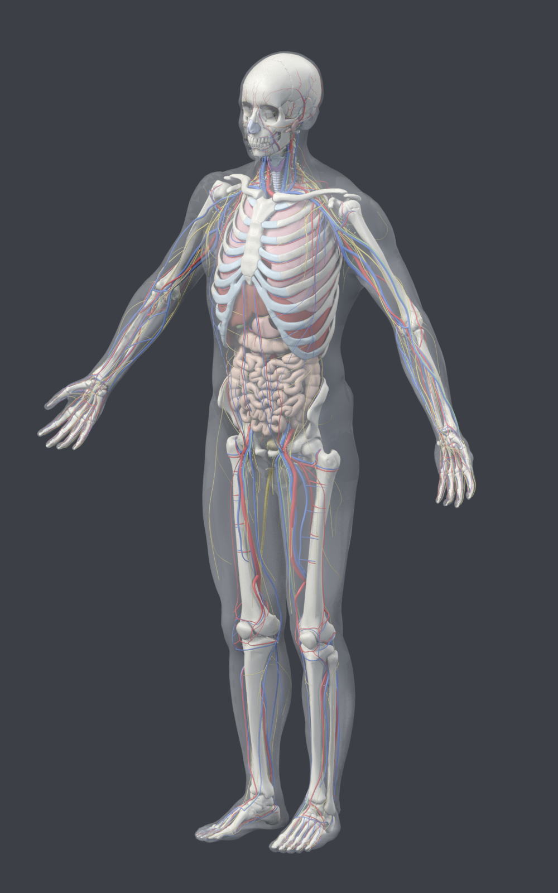

# Crew Health Check: anatomical digital-twin asset

A modular adult human anatomy model for the Crew Health Check astronaut health-monitoring app. It is built in Blender and
exported as a Three.js-ready GLB. The asset covers anatomy and visualization hooks only: no physiology, sensor logic or
medical interpretation is encoded in it.



## Deliverables

| File | What it is |
|---|---|
| `blender/crew_health_check_master.blend` | Editable master (Blender 5.3, 4.3 M triangles, 396 meshes, no external files) |
| `export/astronaut_digital_twin.glb` | Integrated web model: 600k triangles, 15.0 MB, Y-up |
| `export/systems/astronaut_<system>.glb` | One GLB per system plus `astronaut_anchors_regions_markers.glb`, same root and coordinates |
| `manifests/astronaut_anatomy_manifest.json` | Every node: name, id, system, display name, side, source structures, triangle counts, morph targets, bounds |
| `manifests/astronaut_sensor_anchors.json` | 3 suit-sensor anchors and 8 optional anchors: position, normal, up vector, body region |
| `manifests/astronaut_body_regions.json` | 22 region ids, the right-deltoid sub-region, measurement markers, both body profiles |
| `manifests/astronaut_visualization_contract.json` | System group nodes, the 10 view presets, morph targets, pivots, materials, rig notes |
| `previews/anatomy_preview_*.png` | The 9 required renders (front, back, side, complete, skeleton, organs, cardiovascular, muscular, respiratory) |
| `viewer/index.html` | Three.js test viewer (system toggles, morph sliders, click-to-pick) |
| `viewer/validate_glb.mjs` | Automated GLB checks (Khronos validator + Three.js GLTFLoader) |
| `scripts/` | Headless build pipeline; `scripts/build_all.sh` rebuilds everything |
| `scripts/mapping/zanatomy_to_chc.csv` | Every source atlas object → the stable object it went into (or dropped) |

Further reading: [INTEGRATION_THREEJS.md](INTEGRATION_THREEJS.md) (exact node names and code), [VALIDATION.md](VALIDATION.md)
(test results), [LICENSES.md](LICENSES.md) (CC BY-SA 4.0 and the attribution text that must accompany the model).

## Conventions

- Metric units. Reference stature is 1.75 m (a fictional reference profile, profile A), standing on the ground plane.
- Blender: +Z up, the subject faces −Y, the subject's left is +X. glTF / Three.js: +Y up, the subject faces +Z, left is +X.
- `_L` / `_R` always mean the subject's own left and right. This is checked automatically for all 302 lateral meshes.
- Name prefixes: `BODY_`, `BONE_`, `MUSCLE_`, `ORG_`, `VESSEL_`, `SYS_`, `GLAND_`, `LYMPH_`, `ANCHOR_`, `REGION_`, `MEASURE_`, `RIG_`, `MAT_`.
- Every mesh carries `anatomy_id`, `anatomy_system`, `anatomy_name`, `side`, `default_visible`, `interactive`,
  `visualization_type`, `schematic` and `asset_version`, exported as glTF extras (`userData` in Three.js).
- Scene collections: `CREW_HEALTH_CHECK_MASTER` → `01_EXTERNAL_BODY` … `17_PREVIEW_LIGHTS_AND_CAMERAS`.

## What is included

| System | Content (stable object names) |
|---|---|
| External body | `BODY_Skin` (one continuous, manifold, UV-mapped mesh with region ids), `BODY_Eye_L/R`, `BODY_Nails` |
| Skeletal (91) | `BONE_Skull` (`BONE_Cranium`, `BONE_Mandible`, teeth), `BONE_Hyoid`, `BONE_Vertebra_C1…C7, T1…T12, L1…L5`, `BONE_Sacrum`, `BONE_Coccyx`, `BONE_Sternum`, `BONE_Rib_01…12_L/R`, costal cartilages, intervertebral discs, `BONE_Clavicle`, `Scapula`, `Humerus`, `Radius`, `Ulna`, `Carpals`, `Metacarpals`, `Phalanges_Hand`, `Hip`, `Femur`, `Patella`, `Tibia`, `Fibula`, `Tarsals`, `Metatarsals`, `Phalanges_Foot` (all `_L/_R`) |
| Muscular (112) | Pectoralis major/minor, serratus anterior, rectus abdominis, external/internal oblique, transversus, intercostals, latissimus dorsi, trapezius, rhomboids, erector spinae (iliocostalis, longissimus, spinalis), deltoid, rotator cuff, biceps, triceps, brachialis, forearm flexor and extensor groups, hand, gluteus maximus/medius/minimus, deep hip rotators, quadriceps, hamstrings, adductors, sartorius, gastrocnemius, soleus, tibialis anterior, fibulares, foot, neck and face groups (`MUSCLE_*_L/R`) |
| Cardiovascular (93) | `ORG_Heart` with both atria, both ventricles, septum, valves, coronary arteries and cardiac veins; aorta (ascending, arch, thoracic, abdominal), venae cavae, pulmonary trunk/arteries/veins, carotid, vertebral, subclavian, brachial, radial, ulnar, iliac, femoral, popliteal and tibial arteries, the matching major veins, portal, renal and azygos systems, dural sinuses |
| Respiratory (12) | `SYS_NasalCavity`, `SYS_Pharynx`, `SYS_Larynx`, `SYS_Trachea`, `SYS_Bronchi_L/R` (lobar and segmental), `ORG_Lung_L` (2 lobes), `ORG_Lung_R` (3 lobes), `MUSCLE_Diaphragm` |
| Nervous (42) | `ORG_Brain` (cerebrum, cerebellum, brainstem, deep structures), `SYS_SpinalCord`, cauda equina, cranial nerves, brachial plexus, median, ulnar, radial, musculocutaneous and axillary nerves, sciatic, tibial, fibular, femoral and obturator nerves, lumbosacral plexus, intercostal nerves, sympathetic trunks, vagus |
| Digestive (12) | `ORG_Esophagus`, `ORG_Stomach`, `ORG_Liver`, `ORG_Gallbladder`, `SYS_BileDuct`, `ORG_Pancreas`, `ORG_SmallIntestine`, `ORG_LargeIntestine`, `ORG_Rectum`, `ORG_Tongue`, salivary glands |
| Urinary (6) | `ORG_Kidney_L/R`, `SYS_Ureter_L/R` (with renal pelvis), `ORG_Bladder`, `SYS_Urethra` (pelvic part) |
| Endocrine (6) | `GLAND_Pituitary`, `GLAND_Pineal`, `GLAND_Thyroid`, `GLAND_Parathyroid`, `GLAND_Adrenal_L/R` (pancreatic endocrine context = `ORG_Pancreas`) |
| Lymphatic (17) | `ORG_Spleen`, `ORG_Thymus`, `LYMPH_Tonsils`, node groups (head/neck, upper limb, lower limb, thoracic, abdominal, pelvic), `LYMPH_ThoracicDuct`, `LYMPH_Trunks`, `LYMPH_Vessels_UpperLimb/LowerLimb_L/R` (schematic) |
| Interaction | `ANCHOR_SENSOR_CHEST`, `ANCHOR_SENSOR_UPPER_BACK`, `ANCHOR_SENSOR_LEFT_FOREARM`, 8 `ANCHOR_OPT_*`; 22 `REGION_*` markers; `REGION_SHOULDER_RIGHT_DELTOID` overlay; 12 `MEASURE_*` markers |
| Animation | `Heart_Contract` (8 heart meshes), `Lungs_Inhale` / `Lungs_Exhale` (5 lobes + diaphragm), `Profile_B` (second fictional body proportion on the skin), `RIG_Armature` with 52 bones (pelvis, spine ×3, neck, head, clavicles, arms, hands, 15 finger bones per hand, legs, feet, toes) |

Reference profile A (measured on the model, `manifests/astronaut_body_regions.json`): height 1.750 m, inseam 0.788 m,
biacromial breadth 0.366 m, upper arm 0.332 m, forearm 0.250 m, chest 1.097 m, waist 0.836 m, hip 0.988 m, foot 0.261 m.
Profile B has the same height and a heavier build, up to 28 mm more surface on the abdomen, and changes only the outer body.

## Intentionally omitted

- Reproductive anatomy. It is optional in the brief; the `11_REPRODUCTIVE_OPTIONAL` collection is empty and the default skin is sex-neutral at the groin.
- Fascia, bursae, tendon sheaths, retinacula and ligaments; platysma, extra-ocular, laryngeal, pharyngeal and tongue muscles.
- Spinal-cord tracts and nuclei, meninges; inner eye and ear; pleura, peritoneum, omentum, mesentery; liver segments; anal canal.
- Capillaries, microvasculature, neurons, trabecular bone, hair. The full list is in the anatomy manifest.

## Known limitations

- **Not medically validated.** The anatomy comes from one adult male donor dataset (BodyParts3D via Z-Anatomy). It is not an
  astronaut and not clinically accurate geometry; proportions reflect that donor, scaled uniformly to 1.75 m.
- **The A-pose is a geometric re-pose** of an atlas captured in anatomical position. Shoulder soft tissue was blended smoothly.
  The skin shows mild creasing at the armpits, and shoulder vessels and nerves were bent, not re-modelled.
- **Only the external body is skinned** to `RIG_Armature`. Internal systems are rigid and stay in the A-pose.
- **Derived and schematic parts.** The septum is a surface patch of the left ventricle, the rectum was cut from the sigmoid
  colon, and the lymphatic pathways are drawn tubes. All are flagged in the manifest (`derived` / `schematic`).
- The left and right lung and heart shape keys are procedural visual deformations, not simulated mechanics.
- Kidney licensing has an open question; see [LICENSES.md](LICENSES.md).
- Interior faces where atlas meshes overlap were not removed. Decimation keeps every object recognizable but is coarse on
  small bones; the master file keeps full detail.

## Rebuild

```bash
npm install                        # validator + three, once
scripts/build_all.sh               # about 4 minutes on the dev laptop
```

Source download: `https://github.com/Z-Anatomy/Models-of-human-anatomy/raw/master/Z-Anatomy.zip` → `sources/z-anatomy/` → unzip.
The pipeline is: `01_extract_zanatomy` (bake atlas) → `02_assemble` (scale, rename, merge, skin) → `03_apose` →
`04_finalize` (regions, anchors, markers, rig, shape keys, cameras) → `05_export` (decimate, GLBs, manifests) →
`06_validate_blend` + `viewer/validate_glb.mjs` → `07_render_previews`.
